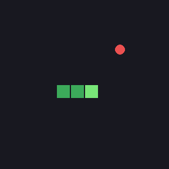
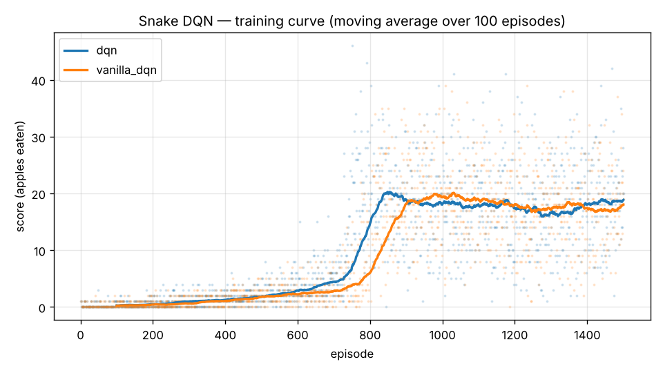

# Snake DQN from scratch (NumPy only)

A reinforcement-learning agent that learns to play Snake by trial and error.
Everything — the neural network, backpropagation, the Adam optimiser and the
Deep Q-Network algorithm — is implemented **from scratch in NumPy**, with no
PyTorch or TensorFlow. Backprop is verified with a numerical gradient check.



## Results

| Policy | Mean score | Median | Max |
|---|---|---|---|
| Random | 0.17 | 0.0 | 2 |
| Greedy heuristic (hand-written) | 20.02 | 20.0 | 41 |
| DQN, no Double (ablation) | 21.55 | 22.0 | 51 |
| **Double DQN (ours)** | **23.66** | **23.0** | 48 |

Evaluated on 100 games with a seed not used in training, 12×12 board.
The *greedy heuristic* is a hand-written baseline: avoid immediate danger, otherwise move towards the food.



## How it works

```
        state s (11 features)
              │
              ▼
   ┌─────────────────────┐        ε-greedy
   │  Q-network  11→128→128→3 │ ──────────────► action a ──► Snake env
   └─────────────────────┘                                     │
              ▲                                          r, s', done
              │  gradient step on Huber loss                   │
              │                                                ▼
   target = r + γ · Q_target(s', argmax_a' Q(s', a'))    replay buffer
              ▲                                                │
              └────────── random mini-batch of 64 ◄────────────┘
```

**Observation** (11 binary features): danger straight / right / left,
current direction (one-hot), food left / right / up / down.
**Actions** (relative): straight, turn right, turn left.
**Reward:** +10 for an apple, −10 for dying, +0.1 / −0.15 for moving
towards / away from the food. Episodes also end if the snake starves (no apple for 100·length steps).

| File | What's inside |
|---|---|
| `snake/nn.py` | MLP (ReLU), hand-written forward & backward pass, He init, Adam |
| `snake/dqn.py` | DQN agent: replay buffer, target network, ε-greedy, Double DQN, Huber loss, gradient clipping |
| `snake/env.py` | Snake environment with a Gymnasium-style `reset()` / `step()` API |
| `train.py` | Training loop, saves the best model by 100-episode moving average |
| `evaluate.py` | Compares DQN vs. random vs. heuristic, plots learning curves, records a GIF |
| `tests/test_core.py` | Gradient check, MLP learns XOR, environment rules |

### Why each DQN ingredient matters

- **Experience replay** — consecutive frames are highly correlated; sampling random past transitions makes gradient updates closer to i.i.d. and reuses data.
- **Target network** — without it the target moves with every update ("chasing your own tail"); a copy synced every 500 steps stabilises learning.
- **Double DQN** — plain DQN takes `max` over noisy Q estimates and systematically overestimates; Double DQN selects the action with the online net and evaluates it with the target net.
- **Huber loss + gradient clipping** — large TD errors early in training would otherwise produce huge, destabilising updates.

## Quick start

```bash
python3 -m venv .venv && source .venv/bin/activate
pip install -r requirements.txt

python -m tests.test_core          # gradient check etc.
python train.py                    # ~5–10 min on a laptop CPU
python train.py --no-double --tag vanilla_dqn   # ablation
python evaluate.py --gif           # results table, curve, demo.gif
```

## Limitations & next steps

- The 11-feature observation only sees one step ahead, so the agent eventually traps itself in its own body on long snakes. Next: give it the full grid as input and use a CNN.
- Results vary between random seeds; next: report mean ± std over several seeds.
- Add Dueling DQN and prioritized experience replay and compare them.
- Port the network to PyTorch and check that results match the NumPy version.
